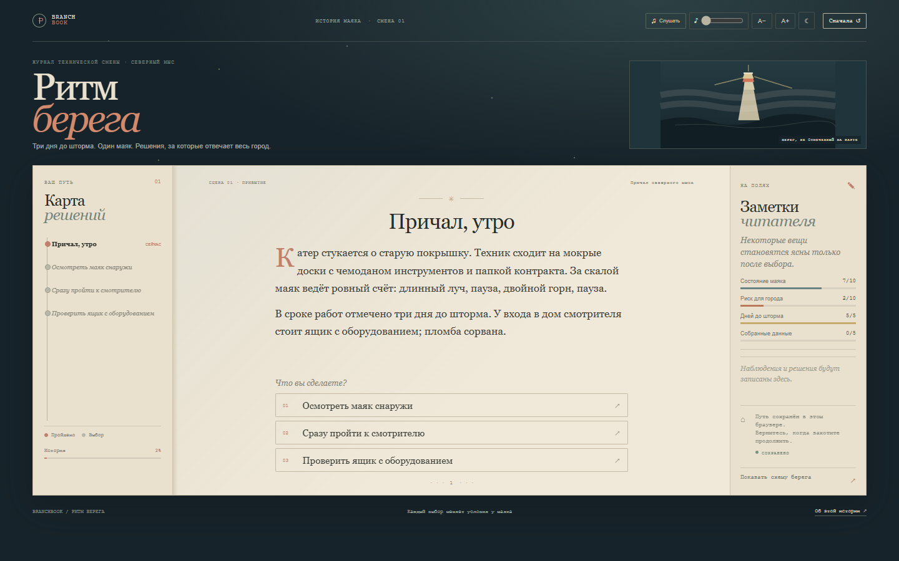

# Branchbook — Rhythm of the Coast

**A story with a lighthouse log instead of a table of contents.** Branchbook is an interactive story about a technician, a failing lighthouse rhythm, and a town facing a storm. Decisions change the route, the working conditions, and the ending across 45 scenes and eight outcomes.

## Русский

«Ритм берега» — интерактивная история о технике, который должен заменить ручное управление маяком автоматикой. Когда выясняется, что сбой ритма может навредить городу, решения приходится принимать по журналам, показаниям ветра и неполным данным. В истории 45 сцен и восемь концовок.

### Что можно делать

- Читать разветвлённую историю с 45 сценами и восемью исходами.
- Сравнивать данные смотрителя, радиста, подростка и инструкции автоматики.
- Следить за состоянием маяка, риском для города, временем до шторма и собранными данными.
- Принимать решения, которые меняют маршрут и доступные варианты.
- Следить за пройденным путём на карте решений.
- Сохранять прогресс автоматически в браузере.
- Видеть, как палитра страницы меняется вместе с местом и настроением сцены; переходы между главами напоминают переворот страницы.
- Автоматически запускать «Fogbound Island» при открытии истории; если браузер блокирует звук, включить его кнопкой в шапке и настроить громкость ползунком. Также можно увеличить текст, включить ночную тему и открыть схему берега.
- Начинать заново в любой момент.

Саундтрек «Fogbound Island» включён в проект. Промпт для создания музыки находится в [SUNO-PROMPT.md](SUNO-PROMPT.md); через кнопку «Музыка» можно выбрать собственный файл.

### Запуск

Откройте `index.html` или запустите локальный статический сервер из этой папки.

## English

*Rhythm of the Coast* is an interactive story about a technician replacing a lighthouse's manual controls with automation. When a faulty rhythm threatens a nearby town, the reader must weigh field notes, wind readings, and incomplete reports. The story contains 45 scenes and eight endings.

### Features

- A branching story with 45 scenes and eight endings.
- Compare records from the lighthouse keeper, radio operator, teenager, and automation manual.
- Track lighthouse condition, town risk, time before the storm, and gathered evidence.
- Choices change the route and which actions are available.
- Follow your route on a live decision map.
- Progress is saved automatically in the browser.
- Chapter colours shift with each place, with a quiet page-turn transition between scenes.
- Start “Fogbound Island” automatically when the story opens; if the browser blocks autoplay, start it with the header button and adjust its volume with the slider. Adjust reading size, switch to a night theme, and open a sketch map of the coast.
- Restart the story at any time.

“Fogbound Island” is bundled with the project. The soundtrack prompt is in [SUNO-PROMPT.md](SUNO-PROMPT.md); use the “Музыка” control to choose another audio file.

### Run

Open `index.html` or serve this directory with a local static web server.

## Design idea

The story is presented as a technician's field journal. The dark sea frame, paper page, lighthouse status marks, and radio notes all belong to the working environment. The route map and the changing page palette make the branching narrative visible without turning it into a conventional game dashboard. Each scene shifts the light and colour to match the place and the immediate risk.
